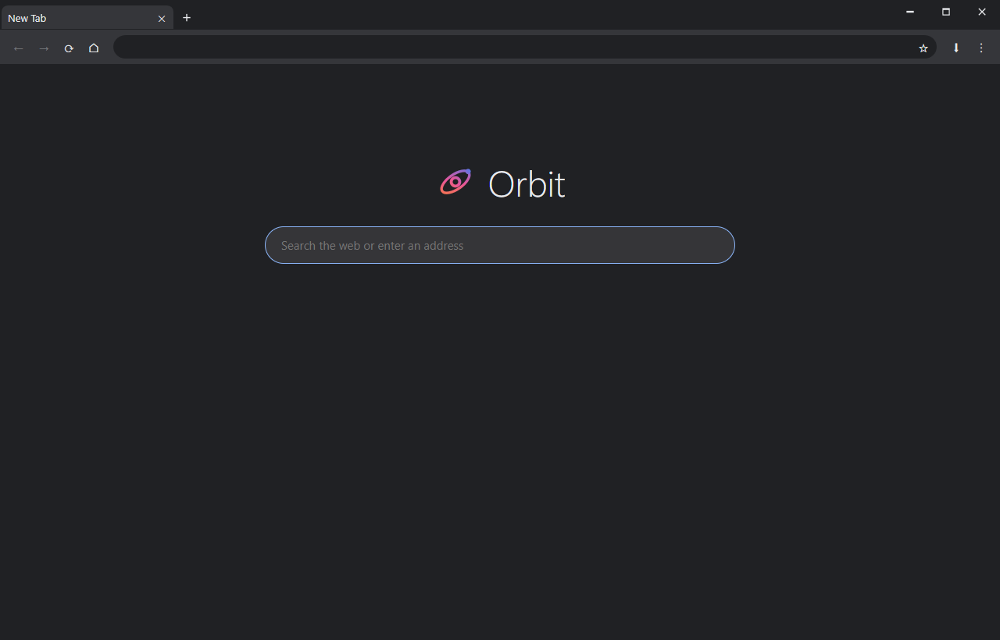

# Orbit


A lightweight Windows browser built on [Microsoft Edge WebView2](https://developer.microsoft.com/microsoft-edge/webview2/), the Chromium-based engine that powers Edge, with a custom title bar, split view, bookmark folders, Chrome extensions and a dark interface.

### [⬇ Download Orbit for Windows](https://github.com/MykePalma/OrbitBrowser/releases/latest/download/Orbit-win-x64.zip)

Unzip anywhere and run `Orbit.exe`. No installer, and no .NET install needed (the .NET runtime is included). Windows 10 or 11, 64-bit. The download is about 75 MB: the browser engine comes from the Microsoft Edge WebView2 Runtime that Windows already includes (Orbit offers to open its download page if a computer doesn't have it).



## Features

- **Microsoft Edge WebView2 engine**: GPU-accelerated rendering, the same web compatibility as Chrome, and H.264 / AAC video. The engine updates itself through Windows.
- **Extensions**: add Chrome extensions straight from the Chrome Web Store ("Add to Orbit" bar), a folder or a zip, or install **uBlock Origin** in one click. They appear as icons next to the address bar, with their pop-ups, and the Web Store ones and uBlock Origin keep themselves up to date.
- **Custom title bar**: tabs sit in the window frame to give pages as much room as possible.
- **Tabs**: drag to reorder, drag a tab out to open it in its own window (or drop it into another Orbit window), pin, mute, duplicate, reopen closed tabs, session restore.
- **Split view**: show two tabs side by side with a draggable divider.
- **Bookmarks**: a bookmarks bar, nested folders, site icons, a bookmark manager with drag-and-drop, and HTML import/export that other browsers can read.
- **Address bar**: search or type a URL, with suggestions from your bookmarks and history.
- **Find in page, zoom, print, save as PDF, view source, DevTools, full screen.**
- **Private windows and tabs** that leave no history or cookies behind.
- **Downloads manager** with progress, pause, cancel and open-folder.
- **Automatic updates** (optional): Orbit checks GitHub for a newer release when it starts, downloads and verifies it in the background, and installs it the next time you open the browser.
- **Settings**: search engine, home page, startup behaviour, download folder, forced dark mode for web pages.

See the **[Wiki](https://github.com/MykePalma/OrbitBrowser/wiki)** for the full guide and keyboard shortcuts.

## Limitations

- Extensions that rely on the `activeTab` permission may not be able to act when you click their button, and extensions don't work in private windows (WebView2 keeps private tabs hidden from them). Extensions you add from a folder or zip are not updated automatically. Orbit has no built-in ad blocker; install uBlock Origin or another extension.
- Needs the Microsoft Edge WebView2 Runtime (already part of Windows 11 and current Windows 10).
- No account sync and no built-in password manager.
- Windows only.

## Build from source

Requires the [.NET 8 SDK](https://dotnet.microsoft.com/download/dotnet/8.0) (or newer) and the WebView2 Runtime on Windows.

```bash
git clone https://github.com/MykePalma/OrbitBrowser.git
cd OrbitBrowser
dotnet run -c Release
```

To produce the downloadable build:

```bash
dotnet publish Lite.csproj -c Release -r win-x64 --self-contained true -o publish/Orbit
```

### Automated self-test

`Orbit.exe --selftest` runs a scripted end-to-end check of tabs, navigation, bookmarks, split view, downloads and more against a local test server. It uses a temporary profile, never your own, and writes `selftest.log` to `%TEMP%\Orbit-selftest`.

## Updates

Settings → **Keep Orbit up to date automatically** (on by default). At start-up Orbit asks the GitHub Releases API for the newest release. If it is newer, Orbit downloads `Orbit-win-x64.zip`, checks it against the SHA-256 checksum GitHub publishes for that file, and unpacks it into a staging folder. A banner offers **Restart to update**; if you ignore it, the update is installed automatically the next time you open Orbit. Nothing is installed unless the checksum matches, and Orbit only contacts `api.github.com` and the release download for updates (and the Chrome Web Store or GitHub when you ask it to install an extension). Turn the setting off to disable the start-up check; **Check for updates** in Settings still works on demand.

## Your data

Bookmarks, history, settings, extensions and the browser cache live in `%APPDATA%\Orbit` (set the `ORBIT_DATA_DIR` environment variable to keep them somewhere else).

## Status

Early release. Bug reports and ideas are welcome in [Issues](https://github.com/MykePalma/OrbitBrowser/issues).
